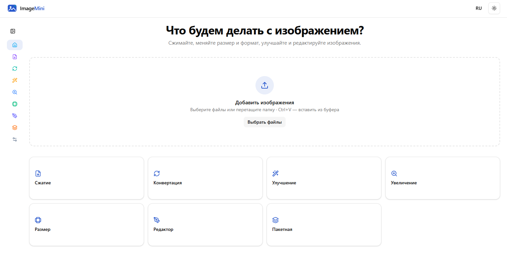
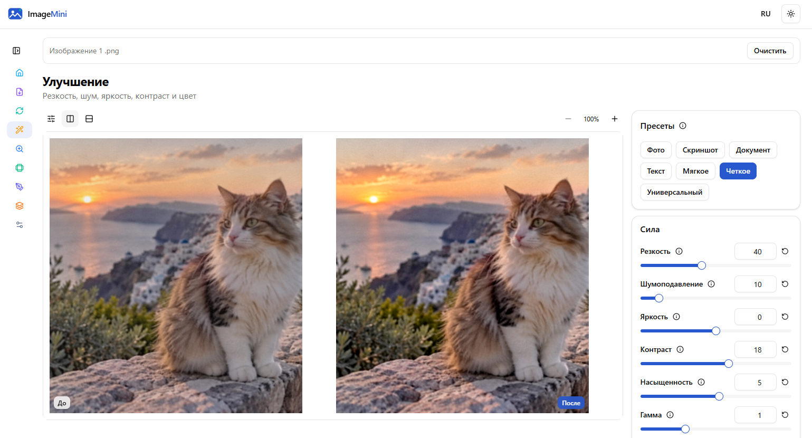
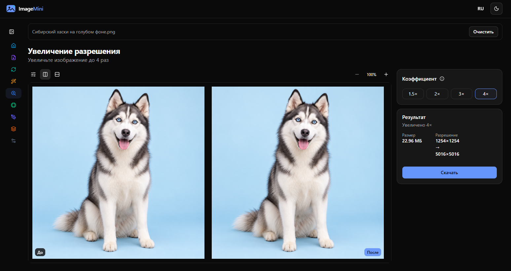

# ImageMini — MVP-приложение для обработки изображений

[English](README.md) | **Русский**

ImageMini — рабочее MVP для обработки изображений в браузере. Сжимайте, конвертируйте, улучшайте, меняйте размер и редактируйте изображения прямо на своем устройстве.

## Скриншоты

<p align="center"><a href="docs/media/01-home.png"></a></p>
<p align="center"><sub>Главная страница · Светлая тема</sub></p>

<table>
  <tr>
    <td align="center" width="50%"><a href="docs/media/02-enhancement.png"></a><br><sub>Улучшение · До и после</sub></td>
    <td align="center" width="50%"><a href="docs/media/03-upscale.png"></a><br><sub>Увеличение Ланцошем · 4× · Темная тема</sub></td>
  </tr>
</table>

## Возможности

- Сжатие JPEG и WebP, оптимизация PNG без потери данных изображения
- Конвертация между JPEG, PNG и WebP
- Улучшение изображения с настройками и пресетами
- Изменение размера по пикселям, процентам или длинной стороне
- Увеличение в 1,5×, 2×, 3× или 4× интерполяцией Ланцоша
- Редактор: кадрирование, поворот, отражение, инструменты «Заплатка», лассо и временные слои с мягким и жестким ластиками
- Пакетная обработка с прогрессом, отменой, скачиванием файлов и ZIP-экспортом
- Интерфейс на русском и английском; светлая, темная и системная темы

## Технологии

- React 19 и TypeScript
- Vite 7
- Tailwind CSS 4 и Radix UI
- Canvas 2D и Web Workers для отдельных ресурсоемких операций
- fflate для ZIP-экспорта и оптимизации PNG без потерь

## Архитектура

ImageMini — одностраничное приложение и PWA на Vite. Обработка изображений выполняется на устройстве пользователя; файлы не отправляются на сервер обработки. Экраны операций находятся в `src/pages/`, общие компоненты и рабочие области редактора — в `src/components/`, обработка изображений, геометрия, вывод файлов, локализация и workers — в `src/lib/`. Большинство операций использует Canvas 2D; отдельные задачи улучшения, изменения размера и заплатки выполняются в Web Workers. Подробности — в [docs/ARCHITECTURE.md](docs/ARCHITECTURE.md).

## Запуск

Требуется Node.js 20 или новее.

```powershell
npm ci
npm run dev
```

Откройте локальный адрес, который покажет Vite. Production-сборка и локальный просмотр:

```powershell
npm run build
npm run preview
```

## Проверки

```powershell
npm run typecheck
npm test
npm run build
npm audit
```

## Ограничения

- Результат «Заплатки» зависит от выбранного участка-донора; на сложных текстурах и освещении могут быть заметны швы.
- Большие изображения и увеличение Ланцошем могут обрабатываться несколько секунд; размер ограничен возможностями canvas в браузере.
- Поддержка AVIF, HEIC и TIFF зависит от декодера браузера.
- Vite предупреждает, что основной JavaScript-бандл больше 500 КБ.
- Текстовый инструмент пока отключен.

## Лицензия

MIT. Copyright (c) 2026 Viktoria Penchuk. См. [LICENSE](LICENSE). Уведомления о сторонних компонентах перечислены в [THIRD_PARTY_NOTICES.md](THIRD_PARTY_NOTICES.md).

## Автор

[Профиль vika-penchuk-dev на GitHub](https://github.com/vika-penchuk-dev).


